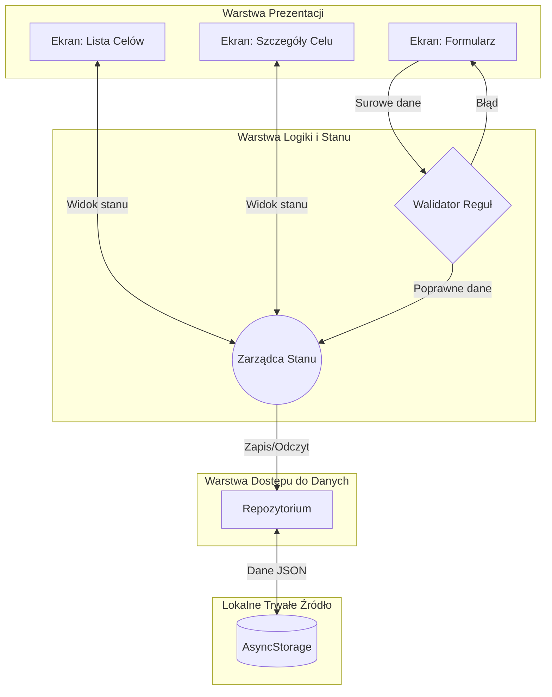
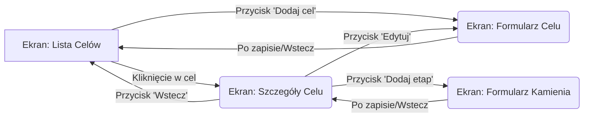
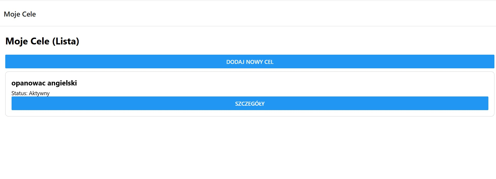
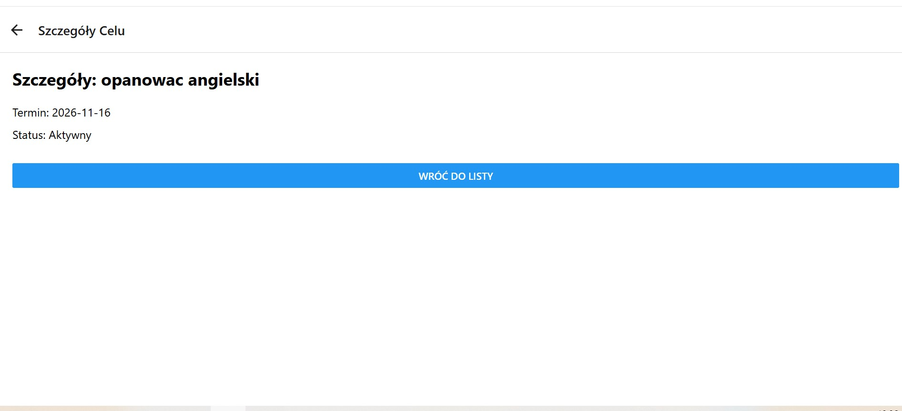
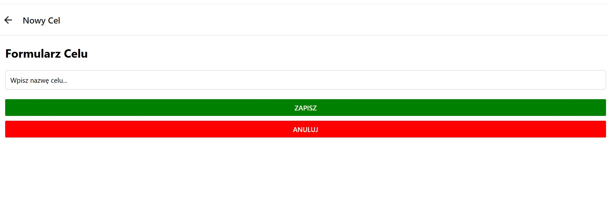

# Sprawozdanie — Laboratorium 2

**Przedmiot:** Budowa aplikacji mobilnych z użyciem technologii frontendowych  
**Student / identyfikator:** Lavreniuk Ella  
**Projekt biznesowy:** MOB-MOB-003 – GoalPlanner  
**Framework:** [React Native / Flutter / NativeScript]  
**Data zajęć:** [2026-11-05]  
**Repozytorium:** (https://github.com/EllaLavreniuk/MOB-003-GoalPlanner.git)  
**Commit / tag odpowiadający oddaniu:** [hash / tag]

> Wypełnij na podstawie własnych działań. Odpowiedzi powinny zawierać dowody (pliki, commity, PR, wyniki uruchomienia), nie same deklaracje.

## T1. Analiza podejść do tworzenia aplikacji

**Cel:** świadomy wybór podejścia w kontekście wymagań własnego projektu.

1. Wymień trzy wymagania biznesowe/niefunkcjonalne swojego projektu, które wpływają na wybór technologii.
2. Porównaj podejście natywne, hybrydowe WebView, wieloplatformowe i PWA pod kątem tych wymagań.
3. Uzasadnij, dlaczego wybrany w laboratorium 1 framework pozostaje odpowiedni, albo opisz zmianę decyzji.

Wypełnij na podstawie własnych działań. Odpowiedzi powinny zawierać dowody (pliki, commity, PR, wyniki uruchomienia), nie same deklaracje.

## T1. Analiza podejść do tworzenia aplikacji

**Cel:** świadomy wybór podejścia w kontekście wymagań własnego projektu.

1. Wymień trzy wymagania biznesowe/niefunkcjonalne swojego projektu, które wpływają na wybór technologii.
2. Porównaj podejście natywne, hybrydowe WebView, wieloplatformowe i PWA pod kątem tych wymagań.
3. Uzasadnij, dlaczego wybrany w laboratorium 1 framework pozostaje odpowiedni, albo opisz zmianę decyzji.

Wypełnij na podstawie własnych działań. Odpowiedzi powinny zawierać dowody (pliki, commity, PR, wyniki uruchomienia), nie same deklaracje.

## T1. Analiza podejść do tworzenia aplikacji

**Cel:** świadomy wybór podejścia w kontekście wymagań własnego projektu.

1. Wymień trzy wymagania biznesowe/niefunkcjonalne swojego projektu, które wpływają na wybór technologii.
2. Porównaj podejście natywne, hybrydowe WebView, wieloplatformowe i PWA pod kątem tych wymagań.
3. Uzasadnij, dlaczego wybrany w laboratorium 1 framework pozostaje odpowiedni, albo opisz zmianę decyzji.

| Wymaganie z projektu                                                         | Znaczenie dla wyboru technologii                                                                                                                                        | Wniosek                                                                                                                                                                                                    |
| ---------------------------------------------------------------------------- | ----------------------------------------------------------------------------------------------------------------------------------------------------------------------- | ---------------------------------------------------------------------------------------------------------------------------------------------------------------------------------------------------------- |
| **[W1] Niezawodna trwałość danych offline (MOB-003-FR-11)**                  | Aplikacja nie korzysta z zewnętrznego backendu. Wpisane przez użytkownika Cele i Kamienie milowe muszą zostać zachowane w telefonie po ponownym uruchomieniu aplikacji. | Niezbędny jest stabilny, natywny dostęp do lokalnego systemu plików urządzenia (np. SQLite lub AsyncStorage). Wszelkie pamięci oparte o przeglądarkę mogą zostać nieoczekiwanie wyczyszczone przez system. |
| **[W2] Obsługa złożonej logiki biznesowej i relacji (MOB-003-BR-01, BR-04)** | Wymóg przeprowadzenia ścisłych walidacji na urządzeniu (np. zablokowanie daty kamienia milowego po dacie celu, blokada usuwania relacji).                               | Wymagany jest framework z nowoczesnym językiem i architekturą wspierającą separację warstw (UI vs Logika), aby ułatwić automatyczne testowanie reguł biznesowych.                                          |
| **[W3] Jedna baza kodu dla wielu platform (Wymóg organizacyjny)**            | Aplikacja powinna docelowo pozwalać na uruchomienie zarówno na systemie Android, jak i iOS.                                                                             | Tworzenie odrębnych, w pełni natywnych aplikacji jest nierealne czasowo. Konieczny jest wybór technologii pozwalającej na współdzielenie kodu źródłowego (Cross-platform).                                 |

**Porównanie podejść i uzasadnienie:**

- **Podejście natywne (Swift dla iOS / Kotlin dla Androida):** Oferuje najwyższą płynność oraz pełne bezpieczeństwo lokalnego zapisu (W1). Zostaje jednak odrzucone z racji niespełnienia wymogu W3 – jako pojedynczy programista nie będę w stanie w trakcie jednego semestru utworzyć i utrzymać dwóch oddzielnych baz kodu.
- **Podejście hybrydowe WebView (np. Cordova):** Spełnia W3 (jeden kod dla obu platform), jednak interfejs użytkownika jest renderowany w wewnętrznej przeglądarce telefonu. Generuje to słabą wydajność, a magazyn danych jest podatny na niekontrolowane czyszczenie przez system operacyjny, co zagraża realizacji kryterium trwałego zapisu (W1).
- **PWA (Progressive Web App):** Aplikacje PWA pozwalają na bardzo szybki rozwój (W3), jednak mają poważny problem z trwałością danych lokalnych na systemach iOS (przeglądarka Safari agresywnie czyści pamięć Local Storage), co łamie wymóg biznesowy W1.
- **Podejście wieloplatformowe (React Native):** Jest rozwiązaniem optymalnym. Pozwala na napisanie całego kodu logicznego tylko raz (spełnia W3), kompilując go do komponentów natywnych (wyższa wydajność niż WebView). Zapewnia stały, natywny dostęp do pamięci urządzenia przez biblioteki (spełnia W1) i jako pełnoprawna aplikacja mobilna spełnia restrykcyjny wymóg TECH-01.

**Uzasadnienie decyzji:**
Decyzja o wyborze frameworka **React Native (Expo)** jest w pełni trafna. React Native pozwala na ominięcie problemów z powolnym renderowaniem (które ma WebView) oraz czyszczeniem pamięci cache na iOS (które ma PWA). Spełnia on najważniejszy warunek, umożliwiając stworzenie aplikacji autentycznie mobilnej, dostarczając narzędzia do trwałego zapisu relacyjnej bazy celów (W1) w dostępnym reżimie czasowym (W3).

**Wskazane źródła (dokumentacja, artykuły techniczne):**

1.  **Dokumentacja Expo Camera:** https://docs.expo.dev/versions/latest/sdk/camera/ - potwierdzenie łatwej integracji modułu aparatu z jednego kodu źródłowego dla obu platform (weryfikacja wymogu W2).
2.  **React Native Data Fetching & Storage:** https://reactnative.dev/docs/network - analiza sposobów utrwalania danych na urządzeniu w trybie offline (weryfikacja wymogu W1).
3.  **Artykuł "React Native vs PWA: Which one to choose?" (narzędzia dla deweloperów):** Analiza różnic w dostępie do natywnych API (aparat, system plików) na systemie iOS między PWA a aplikacjami cross-platformowymi.

## T2. Projekt architektury aplikacji

**Cel:** zaprojektowanie struktury umożliwiającej dalszy rozwój i testowanie.

### T2.1. Diagram architektury

Dodaj diagram (np. Mermaid w Markdown lub obraz w `docs/diagrams/`) przedstawiający:

- ekrany i komponenty UI;
- zarządzanie stanem / logikę aplikacyjną;
- warstwę dostępu do danych;
- lokalne trwałe źródło danych;
- kierunek przepływu danych.

**Diagram / odnośnik:**



### T2.2. Model danych

Zdefiniuj co najmniej dwie powiązane encje wynikające z indywidualnych wymagań biznesowych.

| Encja             | Pole        | Typ         | Wymagane | Znaczenie                                            |
| ----------------- | ----------- | ----------- | -------- | ---------------------------------------------------- |
| **Cel**           | `id`        | UUID        | Tak      | Unikalny identyfikator głównego celu.                |
| **Cel**           | `nazwa`     | Text/String | Tak      | Nazwa celu (nie może być pusta).                     |
| **Cel**           | `termin`    | Date        | Tak      | Ostateczny termin realizacji celu.                   |
| **Cel**           | `status`    | Enum        | Tak      | Aktualny stan (np. Aktywny, Zakończony, Anulowany).  |
| **Kamień milowy** | `id`        | UUID        | Tak      | Unikalny identyfikator etapu.                        |
| **Kamień milowy** | `parentId`  | UUID        | Tak      | Klucz obcy wskazujący na nadrzędny Cel (`id`).       |
| **Kamień milowy** | `nazwa`     | Text/String | Tak      | Nazwa etapu (nie może być pusta).                    |
| **Kamień milowy** | `termin`    | Date        | Tak      | Termin etapu (musi być <= termin celu).              |
| **Kamień milowy** | `ukończony` | Boolean     | Tak      | Flaga oznaczająca realizację etapu (`true`/`false`). |

**Relacja i sposób zapewnienia spójności (np. usuwanie encji nadrzędnej):**

Pomiędzy encjami występuje **relacja jeden-do-wielu (1:N)**: jeden "Cel" może posiadać wiele przypisanych do niego rekordów "Kamień milowy". Zależność ta jest realizowana poprzez pole `parentId` w encji podrzędnej.

**Zapewnienie spójności (Polityka usuwania):**
Zgodnie z regułą biznesową MOB-003-BR-04, usunięcie encji nadrzędnej (Cel) posiadającej powiązane encje podrzędne (Kamienie milowe) jest **blokowane na poziomie logiki aplikacji**.
Gdy użytkownik spróbuje usunąć Cel, do którego przypisane są jakiekolwiek etapy, operacja zostanie przerwana, a na ekranie pojawi się czytelny komunikat błędu (np. _"Nie można usunąć celu, który posiada przypisane kamienie milowe. Najpierw usuń wszystkie etapy składowe."_). Ten mechanizm twardej blokady gwarantuje integralność danych i zapobiega powstawaniu osieroconych rekordów "Kamień milowy" w lokalnej bazie.

### T2.3. Decyzje projektowe

### T2.3. Decyzje projektowe

| Decyzja                    | Wybrane rozwiązanie                              | Alternatywa                                                                                | Uzasadnienie                                                                                                                                                                                                                                                                |
| -------------------------- | ------------------------------------------------ | ------------------------------------------------------------------------------------------ | --------------------------------------------------------------------------------------------------------------------------------------------------------------------------------------------------------------------------------------------------------------------------- |
| **Zarządzanie stanem**     | Zustand (lub React Context API)                  | Redux Toolkit                                                                              | Dla aplikacji realizującej prosty CRUD z dwiema encjami, Redux wymagałby zbyt dużej ilości powtarzalnego kodu. Zustand/Context jest lekki, w zupełności wystarcza do odświeżania listy celów po powrocie z formularza.                                                      |
| **Przechowywanie danych**  | AsyncStorage (w formacie JSON)                   | Expo SQLite                                                                                | Struktura danych (Cel i Kamień milowy) jest nieskomplikowana, szybki zapis i odczyt zserializowanych obiektów JSON do lokalnego pliku przez `AsyncStorage` jest wydajniejszy w implementacji niż konfigurowanie i pisanie zapytań SQL dla lokalnej, relacyjnej bazy SQLite. |
| **Nawigacja**              | React Navigation (Stack Navigator) / Expo Router | Warunkowe renderowanie komponentów (np. `if(screen === 'list')`)                           | Biblioteka nawigacyjna zapewnia natywne animacje przejść między ekranami, wbudowaną obsługę gestów (np. przesunięcie palcem "wstecz" na iOS) oraz ułatwia bezpieczne przekazywanie parametrów (np. przekazanie `id` Celu do ekranu Szczegółów).                             |
| **Separacja logiki od UI** | Wzorzec Repozytorium i Custom Hooks (w React)    | Umieszczanie całej logiki biznesowej bezpośrednio w komponentach widoku ("Fat Components") | Wydzielenie logiki zapisu oraz walidacji (np. dat kamieni milowych) do osobnych plików bez warstwy wizualnej ułatwia późniejsze pisanie testów automatycznych reguł biznesowych, co bezpośrednio spełnia wymagania ARCH-01 i ARCH-03.                                       |

**Plik `docs/architecture.md`:** [Link do pliku architektury](../architecture.md)

## T3. Nawigacja i ekrany

**Cel:** przygotowanie struktury interfejsu aplikacji.

Zaimplementuj minimum trzy ekrany:

1. listę rekordów;
2. szczegóły wybranego rekordu;
3. formularz dodawania (może być później użyty także do edycji).

**Schemat nawigacji:**



| Ekran              | Plik / komponent             | Przejście do / z ekranu                                                                                                  | Dowód działania                                     |
| ------------------ | ---------------------------- | ------------------------------------------------------------------------------------------------------------------------ | --------------------------------------------------- |
| Lista              | `src/app/index.tsx`          | **Z:** Uruchomienie aplikacji (ekran startowy).<br>**Do:** Szczegóły Celu, Formularz Celu.                               |        |
| Szczegóły          | `src/app/details/[id].tsx`   | **Z:** Lista Celów.<br>**Do:** Lista Celów (wstecz), Formularz Celu (edycja), Formularz Kamienia.                        |  |
| Formularz Celu     | `src/app/form.tsx`           | **Z:** Lista Celów (dodawanie) lub Szczegóły (edycja).<br>**Do:** Poprzedni ekran (po pomyślnym zapisie lub anulowaniu). |  |
| Formularz Kamienia | `src/app/milestone-form.tsx` | **Z:** Szczegóły Celu (dodawanie etapu).<br>**Do:** Szczegóły Celu (po pomyślnym zapisie lub anulowaniu).                | _(Zostanie zaimplementowane w Lab 3)_               |

**Dlaczego taki układ nawigacji jest odpowiedni dla użytkownika?**

Powyższy układ oparty na stosie (Stack Navigation) jest standardowym i najbardziej intuicyjnym wzorcem (Master-Detail) dla aplikacji typu CRUD. Użytkownik rozpoczyna od szerokiego kontekstu (Lista Celów), skąd może zagłębiać się w szczegóły wybranego projektu, unikając przeładowania informacjami na głównym widoku. Zastosowanie dedykowanego, osobnego ekranu dla Formularza wymusza na użytkowniku skupienie się wyłącznie na procesie wprowadzania i walidacji danych (np. sprawdzaniu czy data etapu nie przekracza daty celu), minimalizując ryzyko pomyłki. Dodatkowo, nawigacja stosowa natywnie wspiera znane gesty systemowe (np. przesunięcie palcem od lewej krawędzi, aby wrócić do listy), co zapewnia wysoką ergonomię (UX-01) i poczucie korzystania z pełnoprawnej aplikacji mobilnej.

## T4. Operacje Create i Read

**Cel:** implementacja pierwszych operacji CRUD z trwałym przechowywaniem danych.

Zaimplementuj:

- dodanie rekordu głównej encji;
- walidację minimum dwóch pól;
- zapis rekordu w lokalnym trwałym magazynie danych;
- odczyt i wyświetlenie listy rekordów;
- otwarcie szczegółów wybranego rekordu.

**Powiązanie z wymaganiami biznesowymi (ID wymagań):**

- **MOB-003-FR-02** (Tworzenie i przeglądanie rekordów "cel")
- **MOB-003-FR-04** (Wyświetlanie listy oraz widoku szczegółów)
- **MOB-003-FR-08** (Walidacja pól obowiązkowych)
- **MOB-003-FR-11** (Zachowanie danych po ponownym uruchomieniu aplikacji)
- **MOB-003-BR-03** (Puste nazwy niedozwolone, poprawne formaty)

| Operacja         | Lokalizacja kodu           | Reguła walidacji / zachowanie                                                                                                                          | Wynik                                                                             |
| ---------------- | -------------------------- | ------------------------------------------------------------------------------------------------------------------------------------------------------ | --------------------------------------------------------------------------------- |
| Create           | `src/app/form.tsx`         | **1.** Pole `nazwa` nie może być puste.<br>**2.** Pole `termin` musi spełniać format daty `YYYY-MM-DD` (wyrażenie regularne).                          | Komunikat błędu (Alert) w razie niespełnienia reguł. Po sukcesie powrót do listy. |
| Read (lista)     | `src/app/index.tsx`        | Brak bezpośredniej walidacji (stan pusty obsłużony właściwością `ListEmptyComponent` w komponencie FlatList).                                          | Płynne wyświetlenie wszystkich Celów z lokalnej pamięci.                          |
| Read (szczegóły) | `src/app/details/[id].tsx` | Odnalezienie rekordu na podstawie dynamicznego parametru `id` z URL (Expo Router). Jeśli brak id, renderuje się widok zastępczy "Nie znaleziono celu". | Prawidłowe wyświetlenie danych pojedynczego Celu w wyizolowanym widoku.           |

**Wyjaśnij przepływ danych po naciśnięciu przycisku „Zapisz”:**

**Wyjaśnij przepływ danych po naciśnięciu przycisku „Zapisz”:**

1. **Warstwa Prezentacji (UI):** Użytkownik klika przycisk "Zapisz", co uruchamia funkcję `handleSave()` w lokalnym komponencie formularza.
2. **Warstwa Logiki (Walidacja):** Funkcja weryfikuje zawartość lokalnego stanu pól (czy nazwa nie jest pusta i czy data ma odpowiedni format). Jeśli walidacja kończy się błędem, proces jest natychmiast przerywany, a na ekranie (bezpośrednio nad polami formularza) pojawia się dedykowany czerwony komunikat tekstowy z ostrzeżeniem.
3. **Modyfikacja Stanu (Zustand):** Jeśli dane są poprawne, komponent formuje obiekt `Cel` (generując unikalne ID biblioteką `react-native-uuid`) i wywołuje akcję `addCel(nowyCel)`. `Zustand` aktualizuje globalną tablicę w pamięci operacyjnej (RAM).
4. **Zapis do Magazynu (Storage):** Skonfigurowane oprogramowanie pośredniczące (Middleware `persist` z Zustand) automatycznie wykrywa mutację stanu. Bez udziału widoków przechwytuje nową tablicę celów, serializuje ją do formatu JSON i nadpisuje wartość w module `AsyncStorage` (trwały zapis w fizycznej pamięci urządzenia dla zachowania danych).
5. **Odświeżenie Widoku (Reaktywność):** Ponieważ komponent "Listy" subskrybuje globalny stan przez hook `useGoalStore`, reactowe drzewo komponentów automatycznie renderuje go ponownie. Następuje wymuszona nawigacja (`router.replace('/')`), a użytkownik widzi zaktualizowaną listę z nowo zdefiniowanym celem.

## T5. Weryfikacja działania i wnioski

Przeprowadź testy manualne i podaj rzeczywiste wyniki.

| ID    | Scenariusz                           | Oczekiwany rezultat             | Wynik (PASS/FAIL) | Dowód / uwagi                                                                                                                                                                                        |
| ----- | ------------------------------------ | ------------------------------- | ----------------- | ---------------------------------------------------------------------------------------------------------------------------------------------------------------------------------------------------- |
| TC-01 | Dodanie poprawnego rekordu           | Rekord jest zapisany i widoczny | PASS              | Po wypełnieniu formularza i kliknięciu "Zapisz", aplikacja automatycznie wraca do głównego ekranu, a nowy cel jest od razu widoczny na liście (FlatList).                                            |
| TC-02 | Próba zapisu pustego wymaganego pola | Zapis zablokowany, komunikat    | PASS              | Próba zapisu z pustym polem "Nazwa celu" skutkuje przerwaniem akcji i wyświetleniem czerwonego komunikatu błędu nad formularzem. Aplikacja nie dodaje pustego rekordu.                               |
| TC-03 | Otwarcie szczegółów rekordu          | Poprawne dane rekordu           | PASS              | Kliknięcie przycisku "Szczegóły" na karcie celu poprawnie przekazuje `id` w parametrze ścieżki i renderuje ekran `details/[id].tsx` z właściwymi danymi (nazwa, termin, status).                     |
| TC-04 | Ponowne uruchomienie aplikacji       | Rekord pozostaje dostępny       | PASS              | Po całkowitym restarcie aplikacji (lub odświeżeniu strony w przeglądarce), dzięki wykorzystaniu middleware `persist` i `AsyncStorage`, wpisane wcześniej cele są natychmiast ładowane i wyświetlane. |
| TC-05 | Brak rekordów                        | Czytelny stan pustej listy      | PASS              | Przy braku elementów w stanie globalnym (Zustand), komponent `FlatList` poprawnie renderuje zdefiniowany `ListEmptyComponent` z informacją: "Brak celów. Dodaj pierwszy!".                           |

**Najważniejszy napotkany problem i sposób rozwiązania:**

- **Problem:** Konflikt domyślnego szablonu nawigacji Expo (opartego na zakładkach/Tabs) z klasycznym stosem nawigacyjnym (Stack) oraz problemy z testowaniem formularza w środowisku webowym (Expo Web). Po odświeżeniu strony, funkcja `router.back()` przestała działać (brak historii przeglądarki), a natywny `Alert.alert()` dla walidacji nie wyświetlał się niezawodnie.
- **Rozwiązanie:** Całkowite redagowanie pliku `_layout.tsx` do postaci czystego stosu (`<Stack>`), co przywróciło natywne zachowanie przełączania ekranów. Dodatkowo, w formularzu zastąpiono alerty systemowe warunkowym renderowaniem czerwonego tekstu błędu bezpośrednio w interfejsie (co poprawiło UX), a `router.back()` zamieniono na wymuszające przekierowanie `router.replace('/')`.

**Co wymaga dalszej pracy przed laboratorium 3?**

Zgodnie z indywidualną specyfikacją biznesową (MOB-003), w kolejnym etapie projektu (Lab 3) wymagana będzie:

1. Implementacja ekranu i formularza dla encji podrzędnej **"Kamień milowy"** oraz powiązanie jej z wybranym "Celem" (klucz obcy `parentId`).
2. Wdrożenie złożonej logiki domenowej: walidacja sprawdzająca, czy data etapu nie przekracza daty głównego celu (MOB-003-BR-01).
3. Obliczanie i wyświetlanie na ekranie listy/szczegółów procentu ukończonych kamieni milowych (MOB-003-FR-10).
4. Zabezpieczenie przed usuwaniem: wdrożenie blokady uniemożliwiającej usunięcie "Celu", jeśli posiada on przypisane do siebie jakiekolwiek "Kamienie milowe" (MOB-003-BR-04).

**Wnioski (3–6 zdań, odnoszące się do własnej implementacji):**

Implementacja drugiej części laboratorium potwierdziła słuszność wyboru frameworka React Native oraz biblioteki Zustand, które wspólnie pozwoliły na zwinne zbudowanie responsywnej i modularnej aplikacji. Zastosowanie nawigacji opartej na Expo Router (układ Stack) okazało się bardzo intuicyjne dla wzorca Master-Detail, choć wymagało ręcznego nadpisania domyślnych szablonów, aby uniknąć błędów podczas przełączania ekranów. Integracja globalnego stanu z modułem AsyncStorage skutecznie zrealizowała kluczowy wymóg biznesowy dotyczący trwałego zapisu danych w trybie offline-first, eliminując potrzebę wdrażania zewnętrznego backendu. Dodatkowo, przeniesienie komunikatów walidacyjnych z systemowych okienek (Alert) na dedykowane teksty błędów w interfejsie znacząco poprawiło ergonomię formularza i stabilność w środowisku webowym. Zbudowana w ten sposób architektura bazowa CRUD dla głównej encji "Cel" stanowi stabilny fundament do wdrożenia złożonych reguł domenowych dla "Kamieni milowych" w kolejnym laboratorium.

## Materiały dowodowe i historia pracy

- Issue(s): [linki]
- Pull Request(s): [linki]
- Commity związane z laboratorium: [SHA / linki]
- Diagramy: [ścieżki]
- Zrzuty ekranu: [ścieżki, np. `reports/assets/lab-02/`]
- Instrukcja uruchomienia: [link do README]

## Użycie narzędzi AI (jeżeli dotyczy)

**Narzędzie i zakres wsparcia:** [np. wyjaśnienie błędu konfiguracji / propozycja porównania]
**Jak zweryfikowano wynik:** [dokumentacja, uruchomienie, test]
**Elementy wykonane samodzielnie:** [opis]

**Warunki formalne:** sprawozdanie w Markdown, czytelne odnośniki do działającego kodu i diagramów, zrzuty ekranu renderujące się w repozytorium, identyfikacja autora i projektu. Oceniana jest zarówno implementacja, jak i zdolność wyjaśnienia własnych decyzji. Brak dowodów wykonania może ograniczyć liczbę punktów.

```

```
